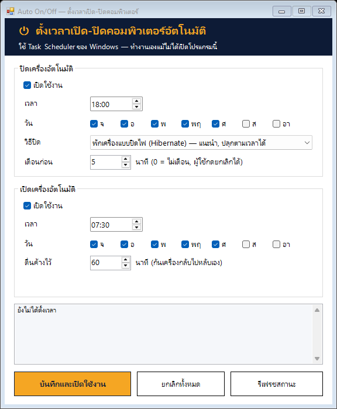

# Auto On/Off — ตั้งเวลาเปิด-ปิดคอมพิวเตอร์อัตโนมัติ

โปรแกรมเล็กๆ สำหรับ Windows 10/11 ตั้งเวลา **ปิดเครื่อง** และ **เปิดเครื่อง** อัตโนมัติตามวัน/เวลาที่กำหนด
ใช้ Task Scheduler ที่มากับ Windows — ไม่ต้องติดตั้งโปรแกรมเพิ่ม, ไม่ต้องเปิดโปรแกรมค้างไว้



## ความสามารถ

- ตั้งเวลาปิดเครื่อง เลือกวันได้ (จ-อา)
- เลือกวิธีปิด 3 แบบ: **ปิดสนิท (Shutdown)**, **พักเครื่องแบบปิดไฟ (Hibernate)**, **พักเครื่อง (Sleep)**
- แจ้งเตือนนับถอยหลังก่อนปิด — ผู้ใช้กด **"ยกเลิก — ยังใช้งานอยู่"** ได้ (ข้ามเฉพาะครั้งนั้น)

  
- ตั้งเวลาเปิด (ปลุก) เครื่อง เลือกวันได้ + ให้เครื่องตื่นค้างไว้ N นาที
- บันทึกประวัติการทำงานที่ `C:\ProgramData\AutoOnOff\log.txt`
- ใช้แบบไม่มีหน้าต่างได้ (สั่งผ่าน command line) สำหรับติดตั้งหลายเครื่อง
- มีเครื่องมือ Wake-on-LAN สำหรับเปิดเครื่องที่ปิดสนิทผ่านเครือข่าย

## วิธีใช้

1. ดาวน์โหลด/clone โปรเจคนี้ไว้ในเครื่อง
2. ดับเบิลคลิก **`Start-AutoOnOff.bat`** → กด "Yes" เมื่อ Windows ขอสิทธิ์ Administrator
3. ตั้งเวลา/วัน/วิธีปิด แล้วกด **"บันทึกและเปิดใช้งาน"**
4. ปิดหน้าต่างได้เลย ระบบทำงานเองตามเวลา

ยกเลิกทั้งหมด: เปิดโปรแกรม → กด **"ยกเลิกทั้งหมด"**

## ⚠️ เรื่องสำคัญ: "เปิดเครื่องอัตโนมัติ" ทำได้แค่ไหน

Windows ปลุกเครื่องเองได้ **เฉพาะตอนที่เครื่องอยู่ในสถานะพัก** (Sleep / Hibernate) เท่านั้น

| วิธีปิด | ประหยัดไฟ | เปิดเองตามเวลาได้ไหม | หมายเหตุ |
|---|---|---|---|
| Hibernate (แนะนำ) | ✅ ไฟดับเหมือนปิดสนิท | ✅ ได้ (เครื่องส่วนใหญ่) | งานที่เปิดค้างไว้ยังอยู่ครบ |
| Sleep | ⚠️ ยังกินไฟเล็กน้อย | ✅ ได้ | ไฟดับ = งานที่ค้างหาย |
| Shutdown | ✅ | ❌ Windows ทำเองไม่ได้ | ต้องใช้วิธีด้านล่าง |

ถ้าต้องการ **ปิดสนิท** แล้วให้เปิดเองได้ มี 2 ทาง:

1. **ตั้งใน BIOS** — เข้า BIOS ตอนเปิดเครื่อง (มักกด `Del` / `F2`) หาเมนูชื่อประมาณ
   *Power On by RTC*, *RTC Alarm*, *Resume by Alarm*, *Auto Power On* แล้วตั้งเวลา (ตั้งแยกจากโปรแกรมนี้)
2. **Wake-on-LAN** — ใช้เครื่องอื่นที่เปิดตลอด (เช่น server) ส่งสัญญาณเปิดผ่านสาย LAN
   ```powershell
   .\tools\Send-WakeOnLan.ps1 -MacAddress 'A4-BB-6D-12-34-56'
   ```
   ต้องเปิด Wake-on-LAN ใน BIOS และใน Device Manager → การ์ดเครือข่าย → Power Management ก่อน
   (ใช้ได้กับสาย LAN เท่านั้น ส่วนใหญ่ใช้กับ Wi-Fi ไม่ได้)

> โน้ตบุ๊กรุ่นใหม่ที่ใช้ *Modern Standby* บางรุ่นปลุกจาก Sleep ด้วย timer ไม่ได้ — ให้ใช้โหมด Hibernate
> เช็คว่าเครื่องรองรับอะไร: เปิด PowerShell พิมพ์ `powercfg /a`

## ติดตั้งหลายเครื่อง (สำหรับฝ่ายไอที)

แก้ไฟล์ตั้งค่าตัวอย่าง [`examples/office.json`](examples/office.json) แล้วรันบนแต่ละเครื่องด้วยสิทธิ์ Administrator:

```powershell
powershell -ExecutionPolicy Bypass -File .\AutoOnOff.ps1 -Apply -ConfigFile .\examples\office.json
```

คำสั่งอื่น:

```powershell
.\AutoOnOff.ps1 -Status   # ดูตารางเวลาปัจจุบัน
.\AutoOnOff.ps1 -Remove   # ยกเลิกทั้งหมด
```

ค่าในไฟล์ตั้งค่า:

| ค่า | ความหมาย |
|---|---|
| `Off.Time` / `On.Time` | เวลา รูปแบบ `HH:mm` (24 ชั่วโมง) |
| `Off.Days` / `On.Days` | วัน: `Monday` … `Sunday` |
| `Off.Mode` | `Shutdown`, `Hibernate`, `Sleep` |
| `Off.WarnMinutes` | เตือนก่อนปิดกี่นาที (0 = ไม่เตือน) |
| `On.StayAwakeMinutes` | หลังปลุกแล้วให้ตื่นค้างไว้กี่นาที (กันเครื่องหลับกลับเอง) |

## ทำงานอย่างไร

เมื่อกดบันทึก โปรแกรมจะคัดลอกสคริปต์ไปไว้ที่ `C:\ProgramData\AutoOnOff\` (ล็อกสิทธิ์ให้แก้ได้เฉพาะ Admin)
และสร้างงานใน Task Scheduler โฟลเดอร์ `\AutoOnOff\`:

| งาน | ทำอะไร | รันในนาม |
|---|---|---|
| `Off-Warning` | แสดงหน้าต่างนับถอยหลัง ณ เวลาปิด | ผู้ใช้ที่ล็อกอินอยู่ |
| `Off-Action` | ปิด/พักเครื่อง หลังเตือนครบเวลา (ถ้าไม่มีใครกดยกเลิก) | SYSTEM |
| `Wake` | ปลุกเครื่องด้วย wake timer แล้วกันไม่ให้หลับ N นาที | SYSTEM |

นอกจากนี้จะเปิด "Allow wake timers" ใน Power Options และเปิด Hibernate ให้อัตโนมัติ (เมื่อเลือกโหมดนั้น)

## โครงสร้างไฟล์

```
AutoOnOff.ps1            โปรแกรมหลัก (หน้าต่างตั้งค่า + command line)
Start-AutoOnOff.bat      ดับเบิลคลิกเพื่อเปิดโปรแกรม
scripts/
  Off-Warning.ps1        หน้าต่างแจ้งเตือนก่อนปิด
  Off-Action.ps1         สั่งปิด/พักเครื่อง
  Wake-Action.ps1        หลังปลุกเครื่อง ให้ตื่นค้างไว้
tools/
  Send-WakeOnLan.ps1     ส่งสัญญาณเปิดเครื่องผ่าน LAN
examples/
  office.json            ตัวอย่างไฟล์ตั้งค่า
```

## แก้ปัญหา

| อาการ | ลองทำ |
|---|---|
| ถึงเวลาแล้วเครื่องไม่ปิด | ดู `C:\ProgramData\AutoOnOff\log.txt` ว่ามีคนกดยกเลิกไหม / เปิด Task Scheduler → โฟลเดอร์ `AutoOnOff` ดู History |
| ไม่ตื่นตามเวลา | รัน `powercfg /waketimers` (Admin) ดูว่ามี timer ไหม, ลองเปลี่ยนเป็นโหมด Hibernate, เช็ค BIOS ว่าไม่ได้ปิด wake |
| ตื่นแล้วจอไม่ติด | ปกติเครื่องตื่นแล้ว แค่จอยังดับ — ขยับเมาส์/กดคีย์บอร์ด |
| โหมด Hibernate ไม่มี | รัน `powercfg /hibernate on` ด้วยสิทธิ์ Admin |
